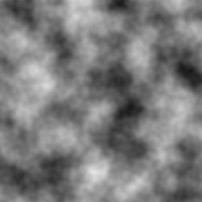
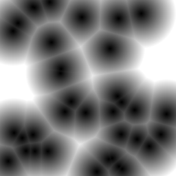
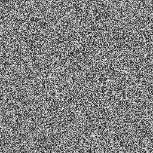
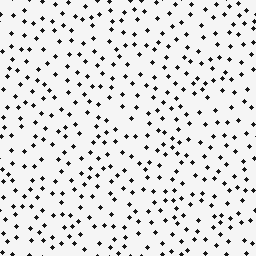

# NoiseKit

一个不依赖第三方库的噪声生成工具。

```sh
cmake -S . -B build
cmake --build build --config Release

noisekit blue
noisekit blue --width 256 --height 256 --frame 3 --output noise.dds
```

默认在当前目录生成 128×128 的 `blue.dds`，格式为 `R8G8_UNORM`。可执行文件位于构建目录（Visual Studio 通常为 `build/Release/noisekit.exe`）。当前使用 Sobol 序列和逐像素数字 scrambling，不使用预计算表；它不保证蓝噪声频谱，也不复现 AMD SSSR 的输出。

| | |
|:---|:---|
| <br>**Perlin Noise（柏林噪声）**<br>连续、平滑，常用于地形、云层和程序化纹理。 | <br>**Worley Noise（细胞噪声）**<br>基于特征点距离，常用于云和细胞纹理。 |
| <br>**White Noise（白噪声）**<br>随机值相互独立，常作为随机采样的基础。 | <br>**Blue Noise（蓝噪声）**<br>抑制低频结构，常用于抖动和随机渲染；图为分散点集示意。 |
