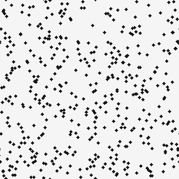
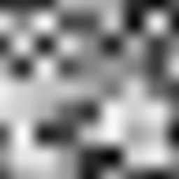

# NoiseKit

NoiseKit 是一个计划不依赖第三方库的简单噪声生成工具。项目的第一个探索方向是 AMD FidelityFX SSSR 使用的蓝噪声采样；目前项目处于设计阶段，尚未实现生成器。

## 游戏中常见的噪声

噪声既可以作为**随机采样的分布**，控制渲染误差出现的位置；也可以作为**连续变化的函数**，生成地形和材质。两者的用途不同，下面的图片用于直观说明，不是算法质量的完整证明。

### 随机采样与抖动

| 白噪声点集 | 蓝噪声风格点集 |
|:---:|:---:|
|  |  |

*示意图：左侧为独立随机点，右侧为 best-candidate 方法生成的分散点集，点数相同。右图仅展示蓝噪声常见的空间分布特征，并非 AMD SSSR 的输出；点集也不等同于可在任意阈值下使用的蓝噪声纹理。*

- **白噪声（White Noise）**：各位置的随机值通常独立，容易出现聚集和空洞。实现简单，常用作随机数基线、粒子扰动等。
- **蓝噪声（Blue Noise）**：抑制低频结构，使误差更多分布在高频；视觉上往往更细碎，也更适合某些空间滤波。可用于抖动、随机透明、环境光遮蔽和随机反射等。蓝噪声不是指图像呈蓝色。
- **时空蓝噪声（Spatiotemporal Blue Noise）**：同时关注每帧的空间分布和每个像素随时间的分布，适用于结合时间累积或降噪的随机渲染。逐帧使用普通空间蓝噪声，并不自动保证时间轴也具有蓝噪声性质。
- **交错梯度噪声（Interleaved Gradient Noise，IGN）**：一种适合屏幕空间采样的确定性图案，常用于抖动和时间抗锯齿相关场景；它和蓝噪声的空间及时间性质并不相同。

### 程序化纹理与形状

| 值噪声 | Worley 噪声 |
|:---:|:---:|
|  |  |

*示意图：值噪声对随机格点值插值；Worley 图显示到最近特征点的距离。参数和组合方式会改变最终外观。*

- **值噪声（Value Noise）**：插值随机格点值，产生平滑变化，可作为云雾、地形和材质的基础。
- **Perlin / Simplex 噪声**：通过格点梯度等构造连续变化，常用于自然纹理、地形和动画；Simplex 使用不同的网格划分。它们不等同于上图的值噪声。
- **Worley / Cellular 噪声**：基于到特征点的距离，形成细胞状结构，可用于石材、裂纹、云和水面纹理。
- **分形布朗运动（fBm）**：将多个不同频率、振幅的噪声叠加，是一种组合方式而非单一的基础噪声算法，常用于增加地形与云的多尺度细节。

## AMD SSSR 与蓝噪声

[FidelityFX SSSR 文档](https://gpuopen.com/manuals/fidelityfx_sdk/techniques/stochastic-screen-space-reflections/)描述了一个独立的蓝噪声纹理生成阶段：根据帧索引和预计算的 Sobol、Scrambling Tile 数据，每帧生成一张 **128 × 128、R8G8_UNORM** 纹理；后续反射阶段用它的随机值进行光线生成。SSSR 再结合降噪处理随机反射带来的噪声。具体行为应以目标版本的源码为准。

因此，生成一张视觉上分散的灰度蓝噪声图，与复现 SSSR 的双通道、逐帧采样并不是同一个目标。后续设计需要先明确是追求类似的统计特性，还是与某个 SSSR 版本的输出兼容。

## 参考资料

- [AMD FidelityFX SSSR：算法与资源说明](https://gpuopen.com/manuals/fidelityfx_sdk/techniques/stochastic-screen-space-reflections/)
- [AMD FidelityFX SSSR：效果与背景](https://gpuopen.com/fidelityfx-sssr/)
- [Scalar Spatiotemporal Blue Noise Masks](https://research.nvidia.com/publication/2021-12_scalar-spatiotemporal-blue-noise-masks)
- [A Survey of Procedural Noise Functions](https://graphics.cs.kuleuven.be/publications/LLCDDELPZ10STARPNF/)

## 许可证

[MIT](LICENSE)
